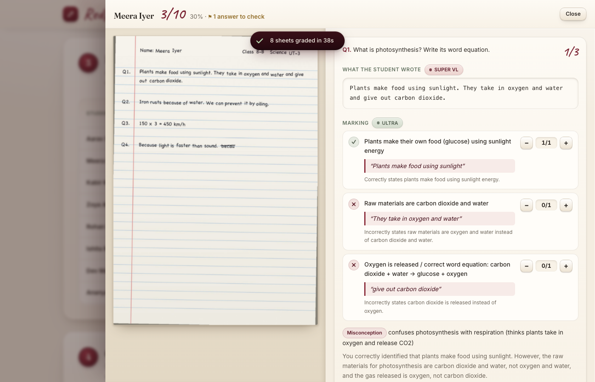
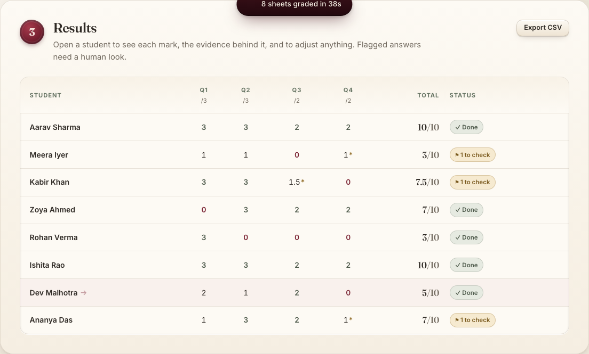
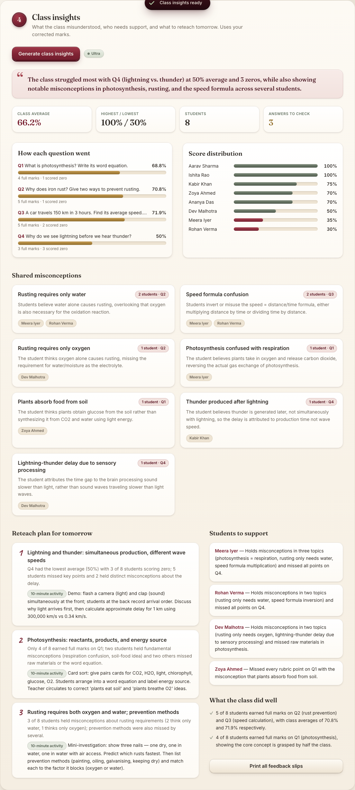
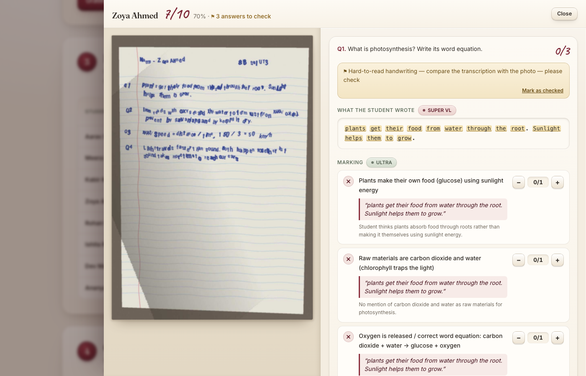
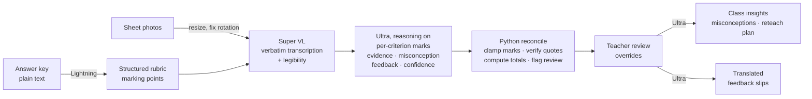

# Redpen ✍️

**Redpen grades a stack of handwritten answer sheets in minutes — and shows its working.**
Photograph the sheets. Redpen reads the handwriting, marks every rubric point with the student's own words as evidence, flags anything it is unsure about, and tells you what the whole class misunderstood. The teacher stays in charge of every mark.

Built for the **Nebius x NVIDIA Global AI Hackathon** · Track: **Best Apps & Agents** · Runs on **NVIDIA Nemotron** via **Nebius Token Factory**.

- 🌐 **Live demo:** _add your deployed URL here_ — click **“Try it with a sample class”** or **“Try messy handwriting”**, no sign-up needed
- 🎬 **Demo video:** _add your YouTube link here_
- 📄 License: [MIT](LICENSE)



---

## The problem

A subject teacher often teaches several sections — easily over a hundred students. One unit test means hundreds of handwritten pages, marked in the evenings, by hand. Two things suffer:

1. **Feedback.** By sheet 120, “See me” is all a student gets. Students learn their mark, not their mistake.
2. **Teaching.** The pile of marked papers holds the most useful information a teacher has — *what the class misunderstood* — but nobody has time to tally it, so tomorrow's lesson is planned blind.

Typed-answer auto-graders don't help: most schools still test on paper.

## What Redpen does

| Step | What the teacher sees | Model |
|---|---|---|
| 1. Answer key → rubric | Paste the answer key in plain text; Redpen turns it into precise, checkable marking points | **Nemotron 3.5 Lightning** |
| 2. Read the sheets | Every sheet transcribed word-for-word *including the student's mistakes*; unreadable words highlighted | **Nemotron 3.5 Super VL** (vision) |
| 3. Grade with evidence | Each rubric point: ✓ / ½ / ✗, the exact quote that earned or lost it, a one-line reason, the misconception it reveals, and feedback to the student | **Nemotron 3 Ultra** (reasoning on) |
| 4. Teacher review | Low-confidence or hard-to-read answers are flagged ⚑. One click adjusts any mark; totals update instantly | — (pure code) |
| 5. Class insights | Shared misconceptions grouped across students, per-question breakdown, who needs support, and a 3-step reteach plan with 10-minute classroom activities | **Nemotron 3 Ultra** |
| 6. Parents | Printable feedback slips, translated into Hindi, Tamil, Bengali, Marathi, Spanish or French | **Nemotron 3 Ultra** (reasoning off) |

The **Model ledger** (top right) shows every Nemotron call: model, step, tokens, latency and cost.

| Results | Class insights |
|---|---|
|  |  |

## Measured results

Two sample sets, same 8 students and answers: **neat** handwriting, and **messy** handwriting photographed badly (uneven, cramped letters, scribbled-out words, blur, shadow, skew — one sheet near-illegible on purpose). Full reports: [`eval/RESULTS.md`](eval/RESULTS.md), [`eval/RESULTS_messy.md`](eval/RESULTS_messy.md).

| Metric | Neat (3 runs, 96 answers) | Messy (2 runs, 64 answers) |
|---|---|---|
| Handwriting reading accuracy (word-level) | **99.2%** | **90.9%** |
| Exact agreement with reference marks, per question | **83.3%** | **82.8%** |
| Within ½ mark of reference marks | **100%** | **96.9%** |
| Average error on a student's total (out of 10) | **0.21 marks** | **0.22 marks** |
| Answers off by more than ½ mark | 0 | 2 — **both flagged for teacher review** |
| Cost per sheet (read + grade) | ≈ $0.01 | ≈ $0.01 |

On messy sheets, grading stays almost as accurate as on neat ones because marks depend on meaning, not exact wording — and the only answers Redpen got meaningfully wrong were ones it had already flagged. **Read the limitations below** — these sheets are synthetic.

| Messy sheet: unclear handwriting flagged, transcription next to the photo |
|---|
|  |

## How it works



### Which model does what, and why

| Model (Token Factory ID) | Job | Why this model |
|---|---|---|
| `nvidia/Nemotron-3.5-Super-VL` | Read handwriting | The vision model. Asked to transcribe *verbatim* — never correct spelling or complete answers, because grading must judge what is really on the page. Reasoning off: this is perception, not judgement. |
| `nvidia/Nemotron-3-Ultra-550b-a55b` | Grade; find class misconceptions; translate feedback for parents | Grading is the step where errors cost a student marks, so it gets the strongest reasoning model with thinking enabled. Grouping “plants breathe in CO₂” and “plants take in oxygen” as related errors also needs real reasoning. Translation runs with thinking off (~1 s, < $0.001 per slip): we started on Lightning, but its Tamil and Bengali came out garbled in testing, and a note to parents has to be right. |
| `nvidia/Nemotron-3_5-Lightning` | Structure rubric | Fast and cheap (~$0.0002 per call) for a well-defined text task, so the app stays responsive and credits go to grading. |

Reasoning is switched per call with `chat_template_kwargs: {"enable_thinking": ...}`; all calls use JSON mode.

### Design decisions that make it trustworthy

- **Models judge, code counts.** Totals, clamping to the rubric, half-mark rounding and every class statistic are computed in Python ([`redpen/pipeline.py`](redpen/pipeline.py)). A model can never mis-add a student's marks.
- **Evidence is verified.** If Ultra quotes “evidence” that isn't in the transcription, Redpen drops the quote rather than show invented student text.
- **Uncertainty is surfaced.** Answers with unclear handwriting or grader confidence < 0.7 are flagged for the teacher; unreadable words are highlighted in the transcription.
- **The teacher has the last word.** Any mark can be changed in half-mark steps; changed marks are labelled and feed into the class insights.
- **Robust I/O.** Phone photos are rotation-corrected and downscaled; malformed model JSON is retried; failed sheets can be retried individually.

## Run it locally

Requirements: Python 3.11+ and a [Nebius Token Factory](https://tokenfactory.nebius.com) API key.

```bash
git clone <this repo> && cd redpen
python3 -m venv .venv && source .venv/bin/activate
pip install -r requirements.txt
cp .env.example .env          # then paste your key into .env
python check_setup.py         # confirms the key and the three Nemotron models
uvicorn app:app --reload      # open http://localhost:8000
```

Click **Try it with a sample class**, then **Grade all**.

Run the evaluation: `python eval/evaluate.py --runs 3` and `python eval/evaluate.py --set messy --runs 2` (≈ $0.25 and $0.17 in Token Factory credits).

Test it on **your own handwriting**: write the four sample questions' answers on paper, photograph the page, click *Try it with a sample class*, remove a student, and drop your photo in.

## Deploy

The app is a single container ([`Dockerfile`](Dockerfile)); it needs one secret, `NEBIUS_API_KEY`.

```bash
docker build -t redpen .
docker run -p 8000:8000 -e NEBIUS_API_KEY=... redpen
```

It deploys as-is to any container host (Nebius Serverless Endpoints, Render, Railway, Fly.io). The public demo has a per-IP hourly request limit (`REDPEN_MAX_REQUESTS_PER_HOUR`, default 120) to protect credits.

## Project layout

```
app.py                 FastAPI routes + demo rate limiting
redpen/pipeline.py     rubric → read → grade → reconcile → class report → translate (all prompts live here)
redpen/llm.py          Token Factory client wrapper, JSON parsing/retry, per-call cost ledger
redpen/images.py       photo rotation fix + downscaling
static/                single-page frontend (HTML + Tailwind + vanilla JS, no build step)
samples/               sample answer key, 8 neat + 8 messy answer sheets, reference marks
scripts/make_samples.py  regenerates the sample sheets
eval/evaluate.py       accuracy / cost / latency evaluation → eval/RESULTS.md
check_setup.py         verifies API key and model availability
```

## Limitations (honest list)

- **The evaluation set is synthetic.** The 8 sample sheets are rendered with handwriting fonts — cleaner than real student handwriting — and the reference marks were set by the project author, not an independent teacher. Real-world reading accuracy will be lower. Next step: evaluate on real, consented, anonymised sheets marked by two teachers.
- **On near-illegible handwriting the vision model can “fill in” a plausible answer.** On our deliberately unreadable sample sheet, Super VL sometimes returned a cleaner, textbook-like sentence instead of the student's actual words (70% word accuracy on that sheet). Prompting it to prefer `[?]` over guesses did not fully stop this. Redpen's defence: every hard-to-read answer is flagged “compare the transcription with the photo”, and the photo is shown beside the transcription. Next step: a second, independent reading pass and flagging answers whose two readings disagree.
- **Text answers only, for now.** Super VL describes diagrams and working, but the rubric does not yet award marks for drawn diagrams (e.g. labelling a cell).
- **English answers.** Feedback can be translated, but sheets written in Hindi or other scripts have not been tested.
- **Not for high-stakes exams.** Redpen is designed for classroom tests where a teacher reviews flagged answers — not for board exams without human checking.
- **Privacy.** Sheet images are sent to Nebius Token Factory for inference and are not stored by Redpen. For school deployments, use a zero-data-retention endpoint where Token Factory offers one.

## Built with

NVIDIA Nemotron 3.5 Super VL · NVIDIA Nemotron 3 Ultra · NVIDIA Nemotron 3.5 Lightning · Nebius Token Factory (OpenAI-compatible API) · Python · FastAPI · Pillow · Tailwind CSS

## License

[MIT](LICENSE)
